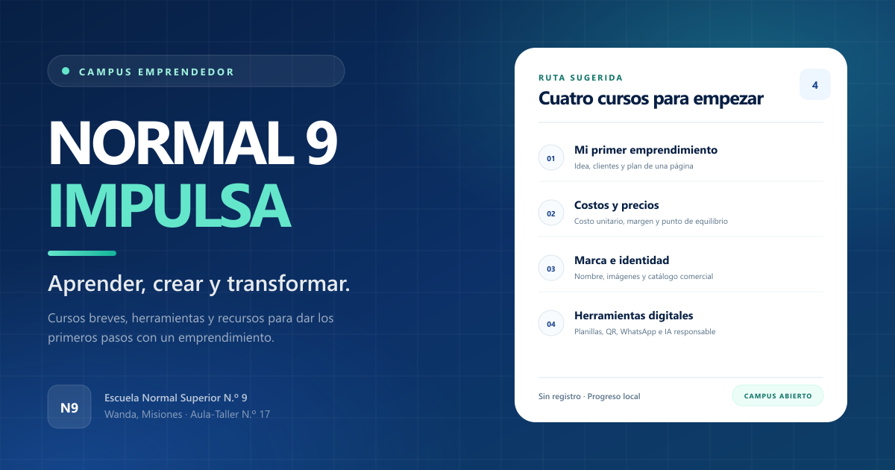

# NORMAL 9 IMPULSA — Campus Emprendedor

Campus educativo abierto de la **Escuela Normal Superior N.º 9 de Wanda, Misiones**, pensado para acompañar los primeros pasos de un emprendimiento. Reúne cuatro cursos breves, autoevaluaciones, una biblioteca de recursos, herramientas externas claramente identificadas, un diagnóstico inicial y páginas institucionales.



> **Estado institucional:** versión inicial del campus. La articulación con organismos públicos es una propuesta en desarrollo. **No existen convenios, avales ni financiamiento externo confirmados.** La Municipalidad de Wanda y el Fondo de Crédito Misiones no figuran como socios, avalistas ni financiadores de esta versión.

---

## 1. Qué incluye

- **4 cursos completos**, con 4 lecciones desarrolladas cada uno (16 lecciones en total):
  1. Mi primer emprendimiento.
  2. Costos y precios para emprender.
  3. Mi marca y mi identidad comercial.
  4. Herramientas digitales para mi negocio.
- **Autoevaluación final por curso** con 6 preguntas, corrección automática, explicación de cada respuesta y aprobación desde el **70 % exacto**.
- **Progreso local**: lecciones completadas, intentos y mejor resultado, guardados solo en el navegador. Incluye reinicio por curso y reinicio total.
- **Constancia de actividad educativa de demostración**, habilitada al completar todas las lecciones y aprobar la evaluación. Se puede personalizar con un nombre opcional e imprimir o guardar como PDF. No es una certificación oficial.
- **Biblioteca** con 7 recursos en 5 categorías, búsqueda, filtro por tipo, contenido completo y descargas reales en CSV cuando corresponden.
- **Herramientas**:
  - **CostoClaro** y **Yo Emprendedor**, como enlaces externos claramente rotulados.
  - **Diagnóstico inicial de mi emprendimiento**, herramienta propia de 10 preguntas, con resultado orientativo, recomendaciones e impresión.
  - Proyectos futuros marcados como **«Proyecto previsto»**, sin enlaces falsos.
- **Jornadas**: una jornada modelo explícitamente identificada como demostración, sin fechas, disertantes ni inscripciones inventadas.
- **Páginas institucionales**: Sobre el proyecto y Conocé el potencial del Aula-Taller.
- **PWA opcional** (service worker en producción), diseño responsive, navegación accesible, estilos de impresión y modo de movimiento reducido.

---

## 2. Stack

| Pieza | Versión / uso |
| --- | --- |
| Next.js | 16.4.3, App Router y exportación estática de las rutas de contenido |
| React | 19.3.1 |
| TypeScript | 5.9.3, modo estricto |
| Tailwind CSS | 4.3.3, configuración CSS-first |
| Lucide React | Iconografía |
| Vitest | 5.0.5, pruebas unitarias |
| Manrope | Fuente variable autoalojada con `@fontsource-variable/manrope` |

No usa base de datos, autenticación, APIs pagas, claves secretas ni servicios de analítica.

---

## 3. Requisitos

- Node.js **20.9 o superior** (verificado con Node 24.21.0).
- npm 10 o superior (verificado con npm 11.19.0).

---

## 4. Puesta en marcha

```bash
npm install
npm run dev
```

El campus queda disponible en:

**http://localhost:3100**

El puerto está fijado en los scripts para no depender del 3000. Si el 3100 estuviera ocupado:

```bash
npx next dev -p 3101
```

### Producción local

```bash
npm run build
npm start
```

También en **http://localhost:3100**.

### Variable de entorno

Copiá `.env.example` a `.env.local` solo si necesitás fijar la URL pública:

```bash
cp .env.example .env.local
```

```env
NEXT_PUBLIC_SITE_URL=https://tu-dominio.example
```

- En desarrollo, si la variable no está definida, se usa `http://localhost:3100`.
- En producción es importante definirla con el dominio real: se utiliza para `metadataBase`, Open Graph, `sitemap.xml` y `robots.txt`.
- No se necesitan otras variables ni secretos.

---

## 5. Scripts

| Comando | Qué hace |
| --- | --- |
| `npm run dev` | Servidor de desarrollo en el puerto 3100 |
| `npm run build` | Compilación optimizada de producción |
| `npm start` | Servidor de producción en el puerto 3100 |
| `npm run test` | Pruebas unitarias y de contenido con Vitest |
| `npm run test:watch` | Pruebas en modo interactivo |
| `npm run typecheck` | Verificación de TypeScript sin emitir archivos |
| `npm run lint` | ESLint |
| `npm run check` | Test + typecheck + lint + build, en ese orden |

---

## 6. Verificación realizada

Resultados obtenidos en este entorno el **24/10/2026**:

| Verificación | Resultado |
| --- | --- |
| `npm run test` | **59 pruebas aprobadas** en 4 archivos |
| `npm run typecheck` | **0 errores** |
| `npm run lint` | **0 errores y 0 advertencias** |
| `npm run build` | **Compilación exitosa**, 49 páginas estáticas generadas |
| Rutas HTTP probadas | **34 respuestas 200** y **404 correcto** para un curso inexistente |
| Enlaces internos | **45 páginas analizadas**, 49 enlaces internos únicos y **0 enlaces rotos** |
| Navegación en navegador | Inicio, cursos, lecciones, evaluación, constancia, biblioteca, herramientas, diagnóstico, jornadas y páginas institucionales |
| Evaluación final | 6/6 respuestas correctas → **100 %**, intento guardado y constancia aún bloqueada sin lecciones |
| Lecciones | 4/4 marcadas desde la interfaz, progreso persistente tras recargar |
| Constancia | Se habilita con 4 lecciones + evaluación aprobada; nombre visible, no persistido; avisos de demostración presentes |
| Reinicio | Confirmación en dos pasos, almacenamiento vaciado y cursos en 0 % |
| Diagnóstico | 10/10 respuestas, resultado **100 % · Avanzado**, recomendaciones y enlaces; respuestas no guardadas |
| Biblioteca | Búsqueda, filtro por categoría, estado vacío y descargas reales |
| Menú móvil | Apertura, foco en el primer enlace, cierre con Escape y `aria-expanded` correcto |
| Enlaces externos | Presentes y rotulados como externos; **no se verificó la disponibilidad de los servicios de terceros** |

Las pruebas cubren, entre otros casos:

- aprobación exacta en el 70 %, redondeo que no debe aprobar (2/3 = 67 %), respuestas sin contestar y fuera de rango;
- normalización de datos corruptos o incompletos en `localStorage`, límite de 25 intentos, reinicio y elegibilidad de constancia;
- puntajes del diagnóstico, límites de nivel, respuestas incompletas y recomendaciones;
- integridad del contenido: 4 cursos, lecciones y evaluaciones válidas, 5 categorías con recursos, enlaces internos existentes y descargas que apuntan a archivos reales.

> Este entorno no realizó ningún despliegue. No se declara una URL pública de producción.

---

## 7. Publicar en GitHub

El proyecto no depende de un repositorio existente. Desde la carpeta del proyecto:

```bash
git init
git add .
git commit -m "feat: campus emprendedor NORMAL 9 IMPULSA"
git branch -M main
git remote add origin https://github.com/Usuario/normal9-impulsa.git
git push -u origin main
```

Reemplazá `Usuario` y el nombre del repositorio por los reales. Antes de publicar, revisá que no se estén subiendo archivos locales (`.env.local`, `.next`, `node_modules`), que ya están excluidos en `.gitignore`.

---

## 8. Publicar en Vercel

1. Subí el proyecto a GitHub (sección anterior).
2. En Vercel, elegí **Add New → Project** e importá el repositorio.
3. Vercel detecta Next.js automáticamente. Configuración esperada:
   - **Framework Preset:** Next.js.
   - **Build Command:** `npm run build`.
   - **Output Directory:** `.next` (valor por defecto).
   - **Install Command:** `npm install`.
   - **Node.js:** 20.9 o superior.
4. En **Settings → Environment Variables**, agregá para Production (y Preview si corresponde):
   - `NEXT_PUBLIC_SITE_URL` = `https://tu-dominio.vercel.app` (sin barra final).
5. Desplegá. Si la variable se agregó después del primer deploy, hacé un **Redeploy** para regenerar metadatos y sitemap.
6. Verificá `/robots.txt`, `/sitemap.xml`, `/manifest.webmanifest` y una ruta de curso en el dominio final.

No se necesitan funciones serverless, base de datos ni secretos. Los enlaces a CostoClaro y Yo Emprendedor son externos y pertenecen a sus propios sitios.

### Dominio propio

Si se configura un dominio institucional, actualizá `NEXT_PUBLIC_SITE_URL` con ese dominio y volvé a desplegar. No cambies rutas internas: los enlaces del campus son relativos.

---

## 9. Estructura del proyecto

```text
src/
  app/                      Páginas y rutas del App Router
    cursos/                 Catálogo, curso, lección, evaluación, constancia
    biblioteca/             Catálogo y detalle de recursos
    herramientas/           Catálogo y diagnóstico
    jornadas/ proyecto/     Páginas institucionales
    aula-taller/ mi-progreso/ privacidad/
  components/
    courses/                Tarjetas, temario, evaluación, constancia
    library/                Explorador y filtros
    tools/                  Tarjetas y diagnóstico
    progress/               Panel de progreso y reinicio
    layout/ providers/ ui/  Navegación, contexto, componentes base
  content/
    courses/                4 cursos completos y registro central
    resources.ts            7 recursos de la biblioteca
    resource-categories.ts  Las 5 categorías
    tools.ts                Herramientas disponibles y previstas
    diagnostic.ts           Preguntas, áreas y avisos
    jornadas.ts             Jornada modelo y contenido demostrativo
    site.ts                 Datos institucionales, enlaces y avisos
  lib/                      Puntajes, progreso, diagnóstico, DTOs y utilidades
  types/                    Tipos compartidos
public/
  recursos/                 Descargas CSV reales
  icons/ og-image.png       Iconos PWA e imagen social
  manifest.webmanifest sw.js
docs/
  COMO-AGREGAR-CONTENIDO.md
```

Las rutas dinámicas usan `generateStaticParams` y `dynamicParams = false`: un curso o recurso inexistente responde 404 y no se generan páginas vacías.

---

## 10. Contenido y edición

La guía detallada está en **[docs/COMO-AGREGAR-CONTENIDO.md](docs/COMO-AGREGAR-CONTENIDO.md)**. Resumen:

- **Cursos:** `src/content/courses/*.ts`, registrados en `src/content/courses/index.ts`.
- **Recursos:** `src/content/resources.ts` y categorías en `src/content/resource-categories.ts`.
- **Herramientas:** `src/content/tools.ts`. Una herramienta prevista no debe tener `href`.
- **Diagnóstico:** `src/content/diagnostic.ts` y cálculo en `src/lib/diagnostic.ts`.
- **Jornadas:** `src/content/jornadas.ts`; no agregar fechas, personas ni inscripciones sin verificación.
- **Datos institucionales y avisos:** `src/content/site.ts`.

Después de editar contenido:

```bash
npm run check
```

Las pruebas de contenido fallan si se rompe una referencia, si una descarga no existe o si una evaluación queda inválida.

### Criterios editoriales

- Español de Argentina, tono claro y directo.
- Ejemplos ficticios siempre identificados como tales.
- No inventar estadísticas, avales, convenios, fechas, disertantes ni resultados.
- No prometer certificaciones oficiales, créditos, subsidios ni beneficios.
- Los enlaces externos deben ser reales, estar rotulados y abrirse en pestaña nueva.
- Las descargas solo se muestran cuando el archivo existe en `public/`.

---

## 11. Privacidad y almacenamiento local

- Clave utilizada: **`normal9-impulsa:progress:v1`**.
- Se guarda: identificadores de lecciones completadas, resultados de evaluación (puntaje, total, porcentaje, aprobado y fecha ISO) y fecha de última actualización.
- **No se guardan** nombres, correos, teléfonos, documentos, respuestas del diagnóstico ni datos sensibles.
- El nombre de la constancia se usa solo en memoria para la vista previa y la impresión; no se persiste ni se envía.
- El diagnóstico se procesa en la página y no se almacena.
- No hay cuentas, cookies de seguimiento, analítica de terceros ni envío de progreso a servidores.
- El progreso se conserva al recargar o cerrar la pestaña, pero se pierde si se borran los datos del navegador y no se sincroniza entre dispositivos.
- El panel **Mi progreso** permite borrar el avance de un curso o todo el progreso, con confirmación.
- El service worker solo cachea recursos públicos del campus; no almacena datos personales.

El aviso completo está en `/privacidad`.

---

## 12. Accesibilidad, impresión y PWA

- HTML semántico, enlace para saltar al contenido, foco visible, etiquetas de formulario y textos alternativos.
- Navegación por teclado; el menú móvil cierra con Escape y recibe foco al abrirse.
- Contrastes y tamaños pensados también para proyección en aula.
- Estilos `@media print` para lecciones, diagnóstico y constancia; la constancia se imprime en A4 y las instrucciones lo indican.
- `prefers-reduced-motion` respetado.
- Manifest e iconos 192/512/apple-touch; el service worker se registra **solo en producción** para no interferir con el desarrollo.
- El progreso y las evaluaciones funcionan sin conexión una vez cargada la página, porque no dependen de un backend.

---

## 13. Límites y decisiones explícitas

- **La constancia es de demostración.** No acredita competencias, no tiene validación en línea y no reemplaza certificaciones oficiales.
- **No hay socios confirmados.** Las menciones a organismos públicos son propuestas o aclaraciones, nunca avales.
- **Las herramientas externas no son del campus.** CostoClaro y Yo Emprendedor se abren en sus propios sitios y pueden requerir registro; su disponibilidad y condiciones no están bajo control de la escuela.
- **No hay backend ni panel administrativo.** El contenido se edita en TypeScript y se publica con un nuevo deploy.
- **No hay jornadas programadas.** La jornada visible es un modelo demostrativo; no se publican fechas ni inscripciones inventadas.
- **El contenido es educativo.** No constituye asesoramiento contable, legal, impositivo ni financiero.
- **El progreso es local.** No se sincroniza entre dispositivos.
- Las cifras institucionales del Aula-Taller se limitan a la información disponible; no se agregan métricas de impacto no verificadas.

---

## 14. Fase futura (no implementada)

Una versión con cuentas y sincronización entre dispositivos podría usar Supabase, pero **no está integrada en esta entrega**. Antes de hacerlo habría que definir:

- autenticación y verificación de edad;
- políticas de acceso por fila (RLS) y separación de datos;
- base legal y consentimiento para datos de estudiantes, muchos de ellos menores;
- retención, exportación y borrado;
- gobernanza institucional de los datos y roles de administración.

Hasta entonces, el campus funciona sin registro y sin recopilar datos personales.

---

## 15. Créditos

Proyecto educativo **NORMAL 9 IMPULSA — Campus Emprendedor** de la Escuela Normal Superior N.º 9, Wanda, Misiones, Argentina. Modalidad Técnico en Gestión y Administración de las Organizaciones (TGA) y Aula-Taller de Simulación Empresarial N.º 17.

No se declara una licencia formal para la marca institucional ni para los contenidos de terceros. Consultar a la institución antes de reutilizar nombres, logos o materiales.
