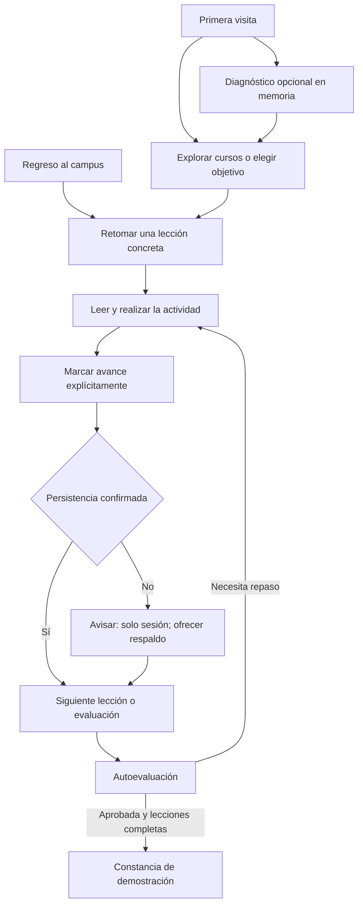

# Campus Emprendedor — NORMAL 9 IMPULSA

## Propuesta de evolución de producto, experiencia y arquitectura

**Fecha:** 1 de noviembre de 2026, Argentina. **Estado:** propuesta para revisión; no implementada en el campus. **Dirección recomendada:** evolución del campus hacia un recorrido de aprendizaje que permita empezar, aplicar y retomar con confianza.

Institución: Escuela Normal Superior N.º 9 “Juan XXIII”, Wanda, Misiones, Argentina. Modalidad TGA; Aula-Taller de Simulación Empresarial N.º 17; Departamento de Ciencias Económicas.

La mejora principal consiste en conectar lo que el campus ya hace bien: convertir cada visita en un siguiente paso comprensible, cada actividad en un avance explícito y cada guardado en una promesa comprobable. La calidad percibida debe venir de esa precisión, de la lectura y de una identidad consistente.

**Recomendación directa [R]:** adoptar la dirección evolutiva, resolver primero persistencia, exportación estática y disponibilidad sin conexión; después mejorar continuidad, descubrimiento y uso en aula. **Decisión del equipo [D]:** dirección visual definitiva, texto institucional, política de cambios de contenido y alcance de las funciones opcionales. Las decisiones se enumeran al final; no bloquean la lectura de la propuesta.

### Alcance y evidencia

Se revisaron código, estilos, contenido, configuración y pruebas del proyecto local. Se ejecutaron nuevamente `npm run test` —**68 pruebas aprobadas en 4 archivos**—, `npm run typecheck` y `npm run lint`, ambos sin errores. No se reconstruyó el sitio ni se volvió a ejecutar Lighthouse en esta revisión. Las **61 páginas y Lighthouse 100 en accesibilidad, buenas prácticas y SEO de un curso** son resultados históricos documentados en el README, fechados el 28/10/2026.

El navegador integrado no logró conectarse. Por eso, este informe distingue **evidencia de código**, **cálculos de contraste**, **hipótesis de usabilidad** y **pruebas pendientes en interfaz**. No afirma haber observado abandono, retención, problemas de personas usuarias ni conformidad WCAG completa.

Se conserva el alcance editorial: 4 cursos, 24 lecciones, evaluaciones de 10 preguntas con aprobación exacta ≥70 %, 9 recursos, 30 términos, 18 preguntas frecuentes y diagnóstico de 10 preguntas. No se agregan convenios, avales, financiamientos, eventos reales, disertantes ni resultados institucionales. No hay backend, cuentas, base de datos, servicios pagos ni secretos. Los ejemplos y estados de los wireframes son ilustrativos, no métricas del campus.

Las rutas y archivos mencionados dentro del documento son relativos a la raíz del repositorio: `C:/Users/juanj/OneDrive/Desktop/Laboratorio emprendimientos`.

---

## A. Diagnóstico UX/UI y técnico

### Fortalezas que deben preservarse

| Fortaleza comprobada | Evidencia | Contrato para v2 |
|---|---|---|
| Identidad visual reutilizable | `src/app/globals.css`: Manrope, escalas brand/sea, botones, tarjetas, inputs y sombras | Evolucionar tokens; evitar una segunda biblioteca de estilos paralela |
| Continuidad dentro del curso | `src/components/courses/CourseActions.tsx` calcula próxima lección, evaluación y constancia | Extraer una única política de siguiente paso y reutilizarla en Inicio |
| Aprendizaje aplicado | Contenido de cursos, actividades y recursos relacionados | Mantener contenido legible y entregables concretos; no sustituirlos por decoración |
| Lógica pedagógica protegida | `src/lib/quiz.test.ts` y `src/lib/progress.test.ts` | Mantener aprobación sin redondeo y constancia condicionada a lecciones + evaluación |
| Privacidad local | Diagnóstico y nombre de constancia en estado React; progreso en localStorage | No persistir respuestas, puntuación ni perfiles derivados del diagnóstico; nombre solo en memoria |
| Búsqueda y recuperación ya existentes | Biblioteca/glosario con normalización, filtros y vacío; respaldo JSON con preview | Ampliar su alcance y robustez; no presentarlos como funciones inexistentes |
| Base accesible | `layout.tsx`, formularios nativos, salto al contenido, impresión y reduced motion | Incorporar pruebas de interacción; conservar semántica y navegación progresiva |

### Hallazgos priorizados

P0 significa riesgo para un contrato fundamental; P1, fricción importante. La prioridad no es una declaración de incidencia observada en producción.

| ID / prioridad | Evidencia concreta | Problema e implicación | Respuesta |
|---|---|---|---|
| A01 · P0 | `next.config.ts:3` no declara `output: "export"`; define `headers()`. `package.json` inicia con `next start` | Prerenderizar 61 páginas no equivale a entregar un artefacto autónomo de exportación estática | P01: exportación real, imágenes compatibles y cabeceras del hosting |
| A02 · P0 | `ProgressProvider.tsx:49,61` lee y después escribe; `progress.ts:82–105,189` normaliza datos no reconocidos a vacío | Un progreso ilegible puede terminar sobrescrito por el estado vacío | P02: lectura discriminada, recuperación y prohibición de escritura automática al montar |
| A03 · P0 | `ProgressBackup.tsx:178` y `LessonCompletionControls.tsx:31` anuncian éxito antes de conocer el resultado del guardado | El mensaje puede prometer persistencia cuando solo cambió la sesión | P02/P03: resultado de persistencia explícito y confirmación honesta |
| A04 · P0 | `public/sw.js:45,55,99` tolera precache parcial, elimina otras cachés del origen y devuelve Inicio como fallback de otra URL | Instalación no demuestra curso descargado; actualización y navegación pueden ser confusas | P06: paquetes verificados, eliminación por prefijo propio y pantalla offline específica |
| A05 · P1 | `globals.css:101` usa `#14b49b` como anillo de foco | Contraste calculado de 2,61:1 sobre blanco y 2,49:1 sobre paper: insuficiente como indicador esencial en esas superficies | P01: foco de doble contraste, revisar también borde y foco de input |
| A06 · P1 | `SiteHeader.tsx:34` cierra con Escape sin enfocar el disparador. `FinalQuiz.tsx:83` intenta enfocar antes de remontar el encabezado | Riesgos de pérdida de ubicación por teclado; reproducción visual pendiente | P01/P05: retorno de foco tras render, pruebas de teclado |
| A07 · P1 | `PageHeader.tsx:32,86`: el último breadcrumb fija azul oscuro aun con encabezado oscuro | Posible pérdida de contraste; confirmar estilos computados en interfaz | P01: variantes semánticas de breadcrumb por superficie |
| A08 · P1 | `src/app/page.tsx:83` ofrece CTAs generales y no reanudación global; `CourseCard.tsx:81` mantiene “Ver curso” | Hipótesis: quien vuelve debe reconstruir su ubicación y elegir de nuevo | P03: siguiente acción concreta desde Inicio y tarjetas |
| A09 · P1 | Navegación con destinos académicos e institucionales; búsquedas separadas por sección | Hipótesis: mayor costo para encontrar conceptos o recursos transversales | P04: búsqueda global y navegación agrupada, conservando URLs |
| A10 · P1 | `progress.ts:268,301` conserva 25 intentos y deriva mejor resultado únicamente de ellos | Una aprobación anterior puede desaparecer después de 25 intentos posteriores | P02: resumen de mejor resultado por revisión independiente del historial acotado |
| A11 · P1 | `site.ts:24` define “uso exclusivo para familias y estudiantes”; `SiteFooter.tsx:105` lo muestra | Contradice el campus abierto y puede sugerir una confidencialidad inexistente en equipos compartidos | P15: revisión editorial institucional |

**Límite de interpretación:** la densidad de Inicio y la navegación son problemas potenciales de orientación. Deben comprobarse con tareas; no hay evidencia para afirmar que causen abandono. Los riesgos de persistencia, caché y contraste sí están sustentados por código o cálculo.

---

## B. Tres direcciones y recomendación

| Dirección | Propuesta y justificación | Ventajas / impacto esperado | Costo relativo y riesgos | Validación |
|---|---|---|---|---|
| Conservadora: campus ordenado | Reordenar acciones, corregir contratos y sistematizar componentes actuales | Familiaridad; menor superficie de regresión; entrega parcial temprana | Bajo–medio; resuelve menos la fragmentación del recorrido | Encontrar curso y retomar sin ayuda; regresiones de rutas y teclado |
| **Evolutiva: recorrido de aprendizaje** | Mantener identidad, incorporar reanudación global, mapa de avance, búsqueda y recursos en contexto | Menos decisiones repetidas y mayor claridad para completar actividades | Medio; exige migración y política única de recomendación | Tiempo/acciones para retomar; tareas de aprendizaje y recuperación completadas |
| Ambiciosa: espacio de proyecto | Organizar todo alrededor de etapas y entregables de un proyecto personal | Mayor integración entre teoría y aplicación | Alto; nuevo modelo editorial y riesgo de acumular datos personales o financieros | Prototipo de tareas antes de desarrollo; demostrar utilidad sobre la evolutiva |

**[R] Elegir evolutiva.** La versión ambiciosa puede explorarse después con selección de etapas y plantillas externas, sin exigir redactar ni guardar información del negocio dentro del campus. Las correcciones P0/P1 aplican a cualquiera de las tres direcciones.

La sensación premium se construye con cinco reglas: una acción principal por momento; textos y estados precisos; medidas coherentes; recursos ligados a actividades; y decisiones reversibles. El escudo conserva su función institucional y nunca se convierte en sello de acreditación. Evitar fotografías de stock que parezcan mostrar estudiantes o jornadas reales, numeradores de impacto, fondos decorativos detrás de textos largos y animaciones de entrada que demoren la lectura.

---

## C. Sistema de diseño v2

### Tokens y composición

Mantener las escalas brand/sea; agregar **roles semánticos** para impedir que cada componente elija colores por su cuenta. Los cambios de apariencia deben reflejar jerarquía y función.

| Familia | Propuesta | Aplicación / razón |
|---|---|---|
| Marca | brand-900 `#0c3168`, brand-950 `#071f43` | Identidad y acción principal; blanco sobre brand-900 tiene contraste calculado 12,69:1 |
| Acento | sea-700 `#0e7467`, sea-50 `#ecfdf8` | Avance, ayuda y actividad; blanco sobre sea-700: 5,66:1. Sea-500 queda decorativo |
| Superficies | canvas `#f6fafc`, surface `#ffffff`, subtle `#eaf3f9` | Separar lectura, acciones y contexto; no apilar tarjetas sin necesidad |
| Texto | ink `#0b1d31`, body `#3f5870`, muted `#566f85` | Body/blanco: 7,39:1; muted/canvas: 4,99:1. No reducir contraste con opacidad |
| Bordes | decorativo `#dbe6ef`; control `#748b9d` | El borde suave no debe ser la única pista de un control; control/blanco: 3,55:1 |
| Estados | success sea-800/sea-50; warning `#854d0e`/`#fffbeb`; danger `#991b1b`/`#fef2f2` | Etiqueta e icono junto al color; probar combinaciones y estados, no solo muestras |
| Tipografía | Manrope local; cuerpo 16 px móvil / 18 px lectura; interlínea 1,65–1,8; medida 62–70ch | Lectura prolongada. Metadatos 14 px; evitar 10–11 px para alcance, duración o privacidad |
| Escala | 14 / 16 / 18 / 20 / 24 / 32 / 40 / 56 px, títulos fluidos con clamp | Jerarquía contenida; título hero más breve; sin texto informativo enorme |
| Espaciado | Unidad 4 px; 8 / 12 / 16 / 24 / 32 / 48 / 64 | Separar grupo, bloque y sección de forma predecible |
| Radios | 8 px controles; 12 px tarjetas; 20 px bloque destacado; pill solo badges | Menos variantes arbitrarias; no usar cápsulas para todo |
| Sombras | Una de tarjeta y otra de elevación; sin sombra en contenido de lección | La elevación identifica capas o acciones; la lectura depende de espaciado |
| Motion | 120–180 ms color/borde; 180–220 ms panel opcional | Feedback breve; sin parallax, carruseles automáticos ni animación de progreso al hidratar |
| Layout | Máximo 78rem; lectura 68ch; columnas laterales desde espacio suficiente | Móvil primero, orden DOM igual al orden de lectura; barra sticky solo si no tapa foco |

Cálculos con luminancia relativa sRGB y colores sólidos; los ratios anteriores no certifican la interfaz completa. Fondos con transparencias y gradientes requieren comprobar el peor caso renderizado.

Ejemplo real de tokens CSS-first para incorporar gradualmente a `src/app/globals.css`; **no se ha aplicado**:

```css
:root {
  --campus-canvas: #f6fafc;
  --campus-surface: #ffffff;
  --campus-text: #0b1d31;
  --campus-control: #748b9d;
  --campus-focus: #0c3168;
}

@theme inline {
  --color-canvas: var(--campus-canvas);
  --color-surface: var(--campus-surface);
  --color-content: var(--campus-text);
  --color-control: var(--campus-control);
  --color-focus: var(--campus-focus);
}

@theme {
  --radius-control: 0.5rem;
  --radius-panel: 0.75rem;
  --shadow-panel: 0 2px 10px rgb(7 31 67 / 7%);
}

@layer base {
  :focus-visible {
    outline: 3px solid var(--campus-focus);
    outline-offset: 3px;
    box-shadow: 0 0 0 3px #fff;
  }
  :where(a, button, input, select, textarea, [tabindex]) {
    scroll-margin-block: 7rem 2rem;
  }
}

@layer components {
  .input-base:focus-visible {
    border-color: var(--campus-control);
    outline: 3px solid var(--campus-focus);
    outline-offset: 3px;
    box-shadow: 0 0 0 3px #fff;
  }
  .lesson-reading { max-width: 68ch; font-size: 1.125rem; }
  .btn[aria-disabled="true"] { cursor: progress; }
}

@media (forced-colors: active) {
  :focus-visible { outline: 3px solid Highlight; box-shadow: none; }
}
```

El ejemplo usa `@theme inline` para alias a variables CSS; conservar `@import "tailwindcss"` y las reglas de reducción de movimiento existentes. Revisar especificidad de estilos antiguos al integrar. El doble anillo necesita prueba en superficies oscuras, controles pequeños y bordes recortados. [Documentación oficial de tokens de Tailwind](https://tailwindcss.com/docs/theme).

### Componentes y estados

| Componente | Contrato | Estados necesarios |
|---|---|---|
| Button / Link | Botón modifica estado; enlace navega; ninguna tarjeta con enlaces anidados | Default, hover, focus, active, ocupado, indisponible con razón; no comunicar solo por opacidad |
| CourseCard | Resultado, duración existente, lecciones, avance y CTA contextual | Sin iniciar / en curso / evaluación pendiente / completo; espera de datos locales sin porcentaje falso |
| ResumeCard | Una acción concreta y explicación breve de por qué se propone | Hidratando / sin avance / recomendación / solo memoria / error |
| LearningRoute | Lista ordenada de etapas; enlaces a todas las lecciones | Pendiente / actual / completada; sin bloqueos ficticios |
| Search / Input | Etiqueta visible, ayuda y error asociado | Vacío, escribiendo, resultados, sin coincidencias, índice no disponible |
| SaveStatus | Diferenciar sesión y persistencia | Cargando / guardado local / solo sesión / recuperación requerida |
| CourseDownload | Disponibilidad independiente de conectividad | No guardado / n de N / listo para revisión X / incompleto / sin espacio |
| Notice / Badge | Estado breve con texto y semántica adecuada | Informativo, advertencia, error, éxito; no todo es `role="alert"` |
| ImportReview | Validación → diferencias → confirmación → resultado | Archivo inválido / versión incompatible / preview / guardando / confirmado / fallo recuperable |

**Dark mode [D/P12]: postergar el modo completo.** Los tokens lo habilitan, pero duplica estados, pruebas, imágenes y errores de contraste. Priorizar lectura, proyección y alto contraste. Si se incorpora después: selector Claro/Oscuro/Sistema, persistir solo preferencia, respetar color-scheme, mantener impresión siempre clara y evitar parpadeo sin cambiar el contenido HTML. Un encabezado oscuro actual no equivale a un tema oscuro probado.

---

## D. Arquitectura de información y descubrimiento

```text
Campus Emprendedor — NORMAL 9 IMPULSA
├── Cursos
│   └── Curso → Lecciones → Autoevaluación → Constancia de demostración
├── Biblioteca → Recurso → Archivo real, cuando existe
├── Herramientas
│   ├── Diagnóstico propio, en memoria
│   └── Servicios externos claramente identificados
├── Institución [grupo de navegación, sin cambiar URLs]
│   ├── Proyecto
│   ├── Aula-Taller
│   └── Jornada modelo de demostración
├── Buscar [nueva ruta /buscar]
└── Mi progreso
    Ayuda: Glosario · Preguntas frecuentes · Privacidad · Uso sin conexión
```

**Encabezado [P04]:** identidad enlazada al Inicio; Cursos, Biblioteca, Herramientas; grupo Institución; Buscar; Mi progreso. En móvil, disclosure de enlaces normales con `aria-expanded` y `aria-controls`, cierre con Escape y retorno al disparador. No usar `role="menu"` para navegación convencional. Evitar un menú de siete destinos de igual peso en pantalla pequeña.

**Pie [P15]:** identidad institucional, acceso a páginas institucionales, ayuda, privacidad y alcance de demostración. Propuesta de texto a validar: “Campus educativo abierto. Tu progreso queda en este navegador. En una computadora compartida, otras personas que usen el mismo perfil pueden verlo.” La política debe hablar del campus, no copiar el aviso de un sistema escolar con cuentas.

**Breadcrumbs [P01]:** Inicio → Cursos → Curso → Lección/Evaluación/Constancia; Biblioteca → Recurso. Último elemento con `aria-current="page"`, sin enlace; nombres breves, ajuste en varias líneas y tono explícito. Mantener IDs y slugs; no introducir redirecciones para cambiar etiquetas visibles.

**Búsqueda global [P04]:** una página estática dedicada con formulario nativo, índice local y enlaces normales. Incluir cursos, lecciones, recursos, términos y preguntas frecuentes; indexar títulos, descripción breve, etiquetas, alias editoriales y anclas verificadas. No incluir respuestas correctas del examen, diagnóstico ni progreso.

Orden propuesto: título exacto → título que contiene términos → etiquetas/alias → extracto. Normalizar mayúsculas, espacios y tildes; usar un corpus de pruebas como “costos”, “precio”, “flujo de caja”, “identidad”, “constancia”, “sin conexion”. No hace falta una API de IA ni motor remoto para este corpus. Las consultas quedan en memoria; no poner texto libre en URL, localStorage o métricas. Filtros por tipo y “Limpiar” visibles; controles de búsqueda siempre accesibles.

Cargar el módulo de búsqueda al entrar en `/buscar`, sin entregar todo el contenido TS al encabezado. Generar el índice en build desde una función TypeScript pura o un runner de desarrollo documentado; no asumir que Node ejecuta cualquier import TS con alias. Presupuesto inicial propuesto: índice ≤100 KiB comprimido, a medir; si excede, recortar extractos antes de añadir dependencias.

**Filtros [P04/P07]:** para cuatro cursos basta Todos / En curso y objetivos editoriales; no introducir un panel de diez filtros. Biblioteca conserva categoría y tipo, y puede sumar relación con curso y favoritos locales opcionales. Una taxonomía compartida —idea/clientes, costos/precios, marca, herramientas— requiere revisión editorial; no renombrar IDs existentes para obtenerla.



Personalización explicable [P03]: respetar primero el curso elegido explícitamente; luego el último curso retomado; dentro de él, última lección incompleta o primera pendiente; al completar lecciones, evaluación; si cumple ambos requisitos, constancia y siguiente curso como opciones. No forzar secuencia ni guardar la puntuación del diagnóstico como perfil. Mostrar “Te proponemos esto porque te falta…” y permitir cambiar de curso.

---

## E. Ocho páginas prioritarias: jerarquía y wireframes

Los siguientes son wireframes textuales propuestos. Cada ficha referencia las propuestas P de la sección F, donde se especifican costo, riesgo y validación.

### 1. Inicio — empezar o retomar [P03, P04, P15]

```text
[Identidad] [Cursos] [Biblioteca] [Herramientas] [Institución] [Buscar] [Mi progreso]
Campus abierto para dar tus próximos pasos con un emprendimiento
┌ Primera visita: [Explorar cursos] [Orientarme con el diagnóstico] ┐
└ Con avance local: Retomá «nombre de lección» [Continuar]          ┘
[Ruta de cuatro cursos: resultado + duración + estado]
[Recurso para aplicar] [Ayuda para elegir un recorrido]
[Institución: resumen breve + acceso a Proyecto / Aula-Taller]
[Alcance y privacidad] [Pie]
```

La identidad y el propósito siempre son estáticos; el bloque de reanudación es una isla cliente pequeña con espacio reservado. No reemplazar toda la portada al hidratar ni mostrar “0 %” antes de leer el progreso. Reducir la competencia entre cursos, herramientas y discurso institucional; toda información sigue disponible en sus páginas. En móvil: propósito → acción → cursos → recursos → institución. Objetivo: retomar en hasta dos acciones desde Inicio.

### 2. Cursos — comparar cuatro opciones [P03, P04]

```text
Inicio / Cursos
Elegí qué querés aprender
[Todos] [En curso]                       [Cómo funciona]
┌ Curso 1: resultado concreto / tiempo / 6 lecciones / estado ┐
│ [Ver programa] [Continuar lección, si corresponde]          │
└ Cursos 2, 3 y 4 con la misma estructura                    ┘
Ruta sugerida: orientativa, sin requisitos de orden
Leer → Aplicar → Autoevaluar → Constancia de demostración
```

Las tarjetas deben ser comparables. No usar la misma etiqueta genérica de CTA para una persona que ya empezó. Separar enlaces; no convertir una tarjeta completa con botones internos en una zona de clic ambigua. No inflar duración o dificultad: usar datos existentes o validar editorialmente cualquier estimación nueva.

### 3. Curso — entender el resultado y el próximo paso [P03, P06, P07]

```text
Inicio / Cursos / Nombre del curso
[Título] → Qué vas a poder producir
[Comenzar / Continuar lección X] [Guardar curso sin conexión]
Lecciones: X de 6                 Evaluación: pendiente/aprobada
Qué vas a aprender · Para quién · Requisitos reales
[Mapa ordenado de lecciones con títulos y estado]
[Recursos relacionados y actividad final]
[Autoevaluación: 10 preguntas, aprobación desde 70 %]
[Condiciones de constancia de demostración]
```

Separar avance de lectura y aprobación. Un 100 % de lecciones no significa constancia habilitada. Todas las lecciones permanecen accesibles. Mostrar peso real del paquete antes de guardarlo y estado de descarga después; no derivar disponibilidad de `navigator.onLine`.

### 4. Lección — leer, aplicar y continuar [P03, P07, P08]

```text
Curso / Lección                         [Imprimir] [Modo aula]
Paso X de 6 · duración orientativa existente
Título y objetivo concreto
┌ Lectura, máximo 68ch                    ┬ Índice del curso ┐
│ Explicación                            │ Lección actual    │
│ Ejemplo identificado como ficticio     │ Otras lecciones  │
│ Actividad: qué hacer y cómo revisarlo  │                  │
│ Recurso relacionado [Abrir / archivo]  │                  │
└ Ideas clave                            ┴──────────────────┘
[Marcar como completada / Deshacer] [Estado de guardado]
[Anterior] [Siguiente lección / Ir a evaluación]
```

El índice pasa a disclosure en móvil. Mantener lectura y actividad en el DOM, sin tarjetas plegadas que oculten contenido esencial. Completar es una decisión explícita; nunca marcar por scroll, tiempo o apertura. No navegar automáticamente al marcar: dejar visible confirmación y deshacer. “Siguiente” permite continuar sin marcar; si se agrega “Completar y seguir”, debe manejar error de persistencia antes de navegar. El modo aula no modifica el progreso.

### 5. Evaluación — evaluar y orientar el repaso [P05]

```text
Curso / Autoevaluación
10 preguntas · aprobación ≥70 % · sin límite de tiempo
Respondidas: X de 10 [Ir a la primera pendiente]
[Pregunta + fieldset/legend + opciones radio]
... diez preguntas, con encabezados y etiquetas claras ...
[Corregir autoevaluación]
Si faltan respuestas: resumen de errores + enlaces a pendientes
Resultado: X/10 · porcentaje · aprobada / seguir practicando
[Explicación por pregunta] [Repasar lección relacionada]
[Volver a practicar] [Curso] [Constancia, si corresponde]
```

Conservar el formulario de diez preguntas; no imponer un wizard por moda. Evaluar cambio de formato solo con evidencia de uso. Los enlaces de repaso se derivan de asociaciones editoriales validadas, no de un modelo que invente orientación. Al repetir, mover foco después de montar la primera pregunta o el encabezado. No guardar respuestas individuales ni respuestas correctas en métricas. Un nuevo intento insuficiente no debe quitar un logro anterior válido para la misma revisión.

### 6. Biblioteca — encontrar un recurso aplicable [P04, P07]

```text
Biblioteca
Recursos para aplicar lo que aprendés
[Buscar recurso] [Categoría] [Tipo] [Limpiar]
N resultados · filtros activos
Recurso → para qué sirve / relacionado con curso / formato
[Ver contenido] [Descargar CSV, solo si el archivo existe]
Vacío: “No encontramos recursos con estos filtros” [Limpiar]
```

Conservar nueve recursos y cuatro descargas reales. Mostrar formato y tamaño medido del archivo; diferenciar abrir una página, imprimirla y descargar un CSV. Favoritos [Could] ayudan a reencontrar; no deben reemplazar búsqueda ni aparecer activos antes de la hidratación. Un recurso sugerido en una lección debe estar a una acción de distancia.

### 7. Herramientas / Diagnóstico — orientar sin perfilar [P03, P09, P15]

```text
Herramientas
[Del campus: Diagnóstico orientativo, 10 preguntas, no se guarda]
[CostoClaro · servicio externo · abre otra pestaña]
[Yo Emprendedor · servicio externo · condiciones del tercero]
[Proyectos previstos, claramente separados]

Diagnóstico: Pregunta N de 10
[Opciones] [Anterior] [Siguiente]
Resultado orientativo en memoria
“Podés empezar por…” + explicación + alternativas
[Ir al curso / recurso] [Imprimir] [Volver a empezar]
```

Mantener el wizard existente, el foco y la salida impresa. No guardar el resultado ni siquiera como “perfil inicial”. La persona puede después elegir un curso como objetivo independiente. Un aviso al salir puede ser inline; evitar confirmaciones modales constantes. Identificar qué pertenece al campus y qué depende de terceros, sin iframes, precarga, gestión de cuentas ni lectura de sus datos.

### 8. Mi progreso — controlar avance y datos [P02, P03, P10, P11]

```text
Mi progreso — en este navegador
[Estado: guardado local / solo sesión / recuperación pendiente]
[Retomar lección concreta] [Cambiar curso que quiero seguir]
[Cuatro cursos: lecciones | evaluación | siguiente acción]
[Historial acotado de intentos + mejor resultado conservado]
[Hitos educativos derivados, sin ranking]
Copias de seguridad: [Exportar JSON] [Importar y revisar]
[Preferencias opcionales] [Métricas locales, apagadas de inicio]
Zona separada: [Borrar progreso] [Borrar todos los datos del campus]
```

Evitar que el respaldo quede después de una lista interminable. Mostrar “archivo generado” si se registra la exportación, sin afirmar que quedó guardado en disco. El estado vacío ofrece cursos y explica localStorage. Un estado ilegible ofrece descargar los datos recuperables y reiniciar explícitamente; no lo disfraza de una primera visita.

---

## F. Funcionalidades priorizadas — MoSCoW

Esfuerzo en **jornadas-persona de implementación y validación**, estimado antes del diseño detallado; no es un compromiso de calendario ni debe sumarse sin resolver solapamientos. Impactos son hipótesis, no porcentajes de mejora prometidos. Cada propuesta incluye problema, solución, justificación, implementación, riesgo y métrica.

| ID / prioridad | Problema → solución y justificación | Impacto esperado / esfuerzo | Implementación y dependencia | Riesgo / validación |
|---|---|---|---|---|
| P01 **Must** | Contratos técnicos y visuales incompletos → export real, tokens semánticos, foco y navegación corregidos | Base verificable / 3–5 j | `next.config.ts`, imágenes locales, cabeceras hosting, CSS y componentes base | Cambiar resolución de rutas; comprobar todo el inventario y teclado, no solo Inicio |
| P02 **Must** | Riesgo de pérdida o falso guardado → repositorio v2, migración, resultados de escritura y mejor intento independiente | Confianza y preservación / 4–6 j | Funciones puras + adaptador localStorage; depende de catálogo/revisiones | Cuota, pestañas, versiones; cero pérdida silenciosa en fixtures y fallos inyectados |
| P03 **Must** | Retomar exige reconstruir contexto → ResumeCard, política única y cierre de lección reversible | Continuidad / 2–4 j | DTO pequeños, provider v2, mapa derivado | Recomendación inesperada; retomar ≤2 acciones, no marcar automáticamente |
| P04 **Must** | Contenido fragmentado → búsqueda global y navegación agrupada | Descubrimiento / 3–4 j | Índice estático, normalización, filtros nativos, rutas existentes | Peso y enlaces obsoletos; corpus editorial con resultados esperados, presupuesto y 0 links rotos |
| P05 **Should** | Error de evaluación poco conectado con la lectura → repaso por concepto | Aprendizaje y nuevos intentos / 2–3 j | Campo `lessonIds`/anclas en preguntas; tests de referencias | Asociación incorrecta; revisión docente de las 40 preguntas, preservar umbral exacto |
| P06 **Must** | Offline parcial no verificable → guardar curso completo con inventario y actualización segura | Continuidad con mala conexión / 5–8 j | Manifiesto postbuild, SW, Cache Storage, indicador independiente de red | Evicción, mezcla de versiones; prueba offline fría de todas las rutas del paquete |
| P07 **Should** | Recursos separados de actividades → enlaces contextuales y metadatos comparables | Aplicación del contenido / 1–2 j | Relaciones por ID desde TS y archivos reales | Duplicación editorial; cada recurso ligado a una actividad válida |
| P08 **Should** | Lectura, impresión y proyección tienen necesidades distintas → modo aula y A4 cuidados | Uso docente / 2–3 j | Variante CSS, controles accesibles, impresión sin estado personal | Ocultar contenido o cortar hojas; prueba real a distancia y PDF A4 |
| P09 **Should** | Orientación no se convierte claramente en acción → una recomendación explicada al terminar diagnóstico | Inicio de recorrido / 1–2 j | Reglas existentes + CTA; estado solo en memoria | Persistir perfil indirecto; storage/export no contienen diagnóstico |
| P10 **Could** | Progreso poco legible → hitos derivados y favoritos limitados | Percepción de avance y retorno / 1–2 j | Derivar logros; guardar solo IDs de recursos si se activa | Confusión con acreditación; pruebas de comprensión, sin ranking ni pérdida de hitos por ausencia |
| P11 **Could** | Falta información para autoobservación → métricas locales opt-in | Reflexión de uso del dispositivo / 2–3 j | Agregados diarios y controles separados, sección L | Sobreinterpretación; apagado sin escrituras, cero transmisión y borrado probado |
| P12 **Could** | Preferencia nocturna → tema oscuro completo, después de consolidar lo anterior | Comodidad para quien lo elija / 2–4 j | Tokens semánticos + Claro/Oscuro/Sistema | Duplica QA; todos los estados contrastados, impresión clara y sin destello |
| P13 **Could** | Dificultad para recordar → aviso al volver o calendario descargable voluntario | Ayuda de organización / 1–2 j | Preferencia local o `.ics` sin nombre/resultado | Prometer alarma cerrada; probar exportación y explicar que depende del calendario |
| P14 **Should** | Constancia existente puede parecer acreditación → composición A4, alcance y preview más claros | Comprensión y uso impreso / 1–2 j | Mejorar `CertificatePanel`, impresión nativa; QR genérico solo si se decide | Apariencia de oficialidad; advertencia visible, nombre ausente de persistencia |
| P15 **Must** | Avisos contradictorios → alcance institucional consistente en toda la navegación | Confianza / 0,5–1 j + revisión institucional | `site.ts`, footer, privacidad, metadatos | Asumir políticas no aprobadas; revisión de “abierto”, terceros y demostración |
| P16 **Won’t** | Tentación de resolver todo con servicios → excluir cuentas, backend, CRM, CMS remoto, IA remota, seguimiento y rankings | Mantener alcance | Contenido TS y despliegue estático | No introducir dependencias por funcionalidades incompatibles |

Accesibilidad, privacidad, contenido y pruebas son parte de cada estimación; no una fase optativa que pueda recortarse. El lanzamiento debe poder excluir Could sin romper el recorrido.

---

## G. Datos locales v2, migración y recuperación

### Contrato actual

La clave es **`normal9-impulsa:progress:v1`**. Guarda `version: 1`, `courses`, `updatedAt`; cada curso tiene `completedLessons: string[]` y hasta 25 intentos con score, total, percentage, passed y completedAt. El respaldo actual usa un envoltorio con `app`, `backupVersion`, `exportedAt`, `progress` y también acepta progreso v1 sin envoltorio. Mantener compatibilidad con ambos formatos válidos.

### Esquema propuesto

```ts
type ISODate = string; // Validar formato/rango al leer; el alias no valida JSON.
type CourseId = string;
type LessonId = string;

interface AttemptV2 {
  id: string; // Local; nunca se envía ni verifica identidad.
  quizRevision: string;
  score: number;
  total: number;
  completedAt: ISODate;
}

interface QuizSummaryV2 {
  bestAttempt: AttemptV2;
  firstPassedAt: ISODate | null;
}

interface CourseProgressV2 {
  lessons: Record<LessonId, {
    completed: boolean;
    changedAt: ISODate | null; // null: fecha desconocida del progreso v1.
  }>;
  attempts: AttemptV2[]; // Los últimos 25, con orden validado.
  quizSummary: Record<string, QuizSummaryV2>; // Por revisión conocida.
}

interface ProgressV2 {
  version: 2;
  contentRevision: string;
  revision: number; // Contador de escrituras; no un reloj global.
  updatedAt: ISODate | null;
  courses: Record<CourseId, CourseProgressV2>;
  lastVisited: {
    courseId: CourseId;
    lessonId: LessonId;
    visitedAt: ISODate;
  } | null;
  savedResourceIds: string[];
}

interface BackupV2 {
  app: "normal9-impulsa";
  backupVersion: 2;
  exportedAt: ISODate;
  progress: ProgressV2;
}

type ReadResult =
  | { kind: "valid"; value: ProgressV2 }
  | { kind: "empty" }
  | { kind: "corrupt" | "future-version"; raw: string }
  | { kind: "unavailable" };

type SaveResult =
  | { kind: "saved"; revision: number }
  | { kind: "memory-only"; reason: "quota" | "blocked" | "unsupported" }
  | { kind: "conflict" };
```

El valor de `app` debe conservar exactamente la constante actual al integrar; no cambiarlo por un título visible. `percentage`, `passed`, elegibilidad y logros se derivan; no duplicar su cálculo en componentes. Conservar `bestAttempt` fuera de la lista de 25 evita perder aprobaciones antiguas. Recalcular datos derivados al importar; un JSON editable no es prueba de identidad ni autenticidad.

| Almacén | Contenido y límites propuestos | Privacidad / borrado |
|---|---|---|
| `normal9-impulsa:progress:v2` | Progreso, próxima ubicación, IDs de favoritos; objetivo <250 KiB | Sin nombres, respuestas, texto libre ni consultas |
| `normal9-impulsa:preferences:v1` | Modo lectura, aula, curso elegido, recordatorio opcional | Nunca guardar una clasificación derivada del diagnóstico |
| `normal9-impulsa:progress:previous` | Una sola copia válida anterior a importación/reemplazo | Mostrar fecha; incluida en borrado de progreso |
| Clave v1 original | Respaldo de migración identificado, no lectura paralela permanente | Ofrecer descarga y limpieza; incluida en borrado de progreso |
| `normal9-impulsa:metrics:v1` | Solo tras opt-in; agregados diarios, 90 días, objetivo <50 KiB | Se elimina al desactivar; nunca se habilita por importar progreso |
| Cache Storage | HTML, JS, CSS, fuentes, imágenes y archivos públicos | Sin nombre, diagnóstico ni progreso; borrar solo prefijos del campus |

Los presupuestos son decisiones internas, **no cuotas garantizadas**. El navegador puede bloquear o eliminar datos; un respaldo en el mismo origen no reemplaza el archivo JSON externo. Un cambio de dominio/puerto no transfiere localStorage automáticamente. [MDN: cuotas y eliminación de datos](https://developer.mozilla.org/en-US/docs/Web/API/Storage_API/Storage_quotas_and_eviction_criteria).

### Migración segura

```text
Leer sin escribir
 ├─ v2 válido → hidratar
 ├─ v2 futuro o corrupto → conservar raw → recuperación / modo sesión
 └─ no existe v2
      ├─ v1 válido → migración pura → validar → guardar v2 → releer
      │                                      ├─ éxito: usar v2, conservar v1
      │                                      └─ fallo: v1 intacto, aviso honesto
      ├─ v1 ilegible → conservar raw, no convertir y persistir vacío
      └─ sin v1 → estado inicial; escribir solo tras acción explícita
```

Migración idempotente: misma entrada produce mismo resultado, sin regenerar IDs con azar en cada montaje. Para intentos antiguos usar IDs deterministas por curso/fecha/posición o asignarlos una sola vez en la transacción validada. Las fechas desconocidas siguen `null`; no reconstruir “días de estudio” retroactivos. Validar totales contra la revisión del cuestionario; conservar resultados históricos compatibles sin atribuirles una fecha de contenido inventada.

**Contenido [D]:** definir `contentRevision` y revisiones de evaluación editorialmente. Agregar una lección no debe borrar avance previo. Mostrar “Se agregó contenido” y distinguir “recorrido completado en revisión anterior” de requisitos actuales. No retirar silenciosamente un logro histórico ni asumir que una nota de una evaluación modificada representa la nueva. La elegibilidad de una nueva constancia depende de una política docente explícita y testeada.

### Escrituras y varias pestañas

Centralizar `dispatch(command)` en un repositorio local: validar comando → adquirir bloqueo → releer estado actual → aplicar función pura → validar → incrementar revisión → persistir → notificar UI. No escribir desde un efecto general cada vez que cambia el estado; una lectura, hidratación o evento `storage` no es una intención de modificación.

Usar Web Locks, si está disponible, con un nombre del campus compartido por todas las pestañas para serializar el tramo lectura-modificación-escritura. Los eventos `storage` solo invalidan/refrescan vistas. El bloqueo no convierte varias claves de localStorage en una transacción: guardar la copia anterior primero y no reemplazar el valor principal si falla una preparación necesaria. [MDN: Web Locks](https://developer.mozilla.org/en-US/docs/Web/API/Web_Locks_API).

Fallback conservador sin Web Locks: edición en memoria y exportación manual; informar que no se garantiza guardado concurrente en ese navegador. Si se decide permitir persistencia sin bloqueo, debe declararse explícitamente que comparar revisiones y releer reduce, pero no elimina, carreras. No vender un contador de revisión como compare-and-swap atómico. Reinicios e importaciones comparten el mismo mecanismo.

### Exportar, importar y borrar

1. Exportar un snapshot validado, con revisión, app y versión. Descarga mediante Blob; revocar object URL después de iniciarla. Nombre de archivo genérico con fecha, sin nombre de participante.
2. Importar desde `File`, límite **2 MiB antes de leer**. Parsear a `unknown`; validar envoltorio y límites estructurales; no usar `as ProgressV2` como validación.
3. Validar cursos/lecciones/recursos conocidos, cadenas acotadas, fechas válidas, números finitos enteros, `0 ≤ score ≤ total`, revisión y total compatible; limitar resúmenes a revisiones conocidas. Reconstruir campos permitidos; no hacer spreads del JSON ni fusionar claves arbitrarias como `__proto__`.
4. Preview: cantidad de cursos/lecciones, mejores resultados, diferencias y elementos descartados; archivo vacío requiere aviso claro. Ofrecer exportación del estado actual.
5. MVP: **reemplazo explícito**, manteniendo el modelo actual y una copia recuperable. Cancelar no modifica nada. Guardar solo al confirmar; anunciar éxito después de persistir y releer. Ante conflicto, invalidar preview y recalcular diferencias.
6. “Combinar” queda fuera del MVP: requiere reglas para desmarcados, reinicios y revisiones. Una unión de listas resucita progreso borrado; no implementarla como atajo.
7. “Borrar progreso” elimina progreso, claves legacy y copias previas del campus tras confirmación; “Borrar todos los datos del campus” incluye preferencias, métricas y paquetes descargados. Nunca `localStorage.clear()` ni eliminar cachés ajenas. No recrear datos borrados desde una pestaña desactualizada.

**Equipos compartidos:** progreso por navegador no es progreso por persona. No simular multiusuario con nombres locales. Explicar cómo exportar, borrar y usar otra sesión/perfil del navegador. Las preferencias e indicadores de actividad no deben proyectarse automáticamente en el modo aula.

---

## H. Accesibilidad, rendimiento, PWA e impresión

### Matriz de verificación

| Control | Umbral de aceptación propuesto | Prueba / evidencia |
|---|---|---|
| Inventario | 4 cursos, 24 lecciones, 40 preguntas de evaluación, 9 recursos, 30 términos, 18 FAQ, 10 preguntas de diagnóstico | Script de inventario editorial + tests de referencias; los tests actuales de contenido incluyen mínimos, no todos estos exactos |
| Rutas | Todas las URLs existentes preservadas; 404 real en desconocidas | Export `out/` en servidor estático; crawler y accesos directos |
| Teclado | Flujos completos sin mouse; foco visible y sin quedar tapado | Inicio → lección → evaluación → repetir → constancia; importar/cancelar; menú Escape |
| Contraste | Texto normal ≥4,5:1; grande ≥3:1; elementos esenciales ≥3:1 | Matriz por superficie y estado, incluyendo focos, errores y breadcrumbs |
| Tamaños | Objetivo de diseño 44×44 CSS px; mínimo AA 24×24 o excepción aplicable | Inspección de controles y separación; no tratar 44 como requisito AA general |
| Reflow | Lectura a 320 CSS px y zoom 400 % sin scroll horizontal indebido | Ocho arquetipos, textos largos, errores, nombres de constancia al máximo |
| Legibilidad | Zoom 200 % y ajustes de espaciado sin pérdida de contenido/función | Interlínea 1,5, separación de párrafo 2, letras 0,12em y palabras 0,16em |
| Semántica y estados | Nombres accesibles, labels, encabezados coherentes; alertas útiles | axe + revisión manual; sin usar color como único estado |
| Lectores de pantalla | Completar flujos clave con NVDA; VoiceOver cuando haya equipo | Registro de navegador/versiones, foco y anuncios reales |
| Movimiento | Reduced motion elimina movimiento no esencial | Preferencia del sistema + prueba de transiciones y scroll |
| Lighthouse | Objetivo 100 de accesibilidad en ocho tipos de página | Reporte por URL/estado, versión, commit y configuración; revisar BP/SEO también |
| Persistencia | Migración/importación sin pérdida silenciosa | Corrupto, futuro, quota, bloqueo, 26.º intento, dos pestañas, reset y roundtrip |
| Privacidad | Cero datos personales/diagnóstico en storage, backup, URL o caché | Inspección de storage y captura de red en flujos completos |
| Offline | Cada archivo del paquete funciona después de descarga confirmada | Offline desde contexto nuevo, recarga directa, evaluación, navegación, fallo parcial y actualización |
| A4 | Sin cortes de información crítica; advertencias legibles | Lección, diagnóstico, constancia; print preview y archivo PDF de muestra |

WCAG 2.2 AA incluye foco no completamente oculto y tamaño mínimo de objetivos de 24 CSS px con excepciones. El proyecto puede adoptar objetivos superiores de diseño sin presentarlos como el mínimo normativo. [WCAG 2.2, W3C](https://www.w3.org/TR/WCAG22/). Un Lighthouse 100 no certifica por sí mismo WCAG: las comprobaciones manuales no forman parte de su puntuación. [Puntuación de accesibilidad de Lighthouse](https://developer.chrome.com/docs/lighthouse/accessibility/scoring).

### Rendimiento y exportación

Corregir la discrepancia arquitectónica mediante `output: "export"`, assets locales y una configuración de hosting que sirva el artefacto. Next genera `out/`; las cabeceras declaradas en Next y el optimizador de imágenes por defecto requieren una alternativa compatible. Verificar las rutas actuales antes de decidir `trailingSlash`; no cambiar su resolución sin pruebas. Reemplazar `next start` por una forma documentada de servir el export y conservar comandos de desarrollo separados. [Next.js: exportación estática](https://nextjs.org/docs/app/guides/static-exports).

Ejemplo orientativo de configuración, sujeto a resolver el hosting y los archivos de imagen actuales:

```ts
import type { NextConfig } from "next";

const nextConfig: NextConfig = {
  output: "export",
  reactStrictMode: true,
  poweredByHeader: false,
  images: { unoptimized: true }, // Archivos optimizados previamente en build.
};

export default nextConfig;
```

No confundir `unoptimized` con haber optimizado archivos. Generar variantes WebP/AVIF cuando aporten valor, conservar PNG/SVG apropiados para identidad, dimensiones explícitas y tamaños reales; no añadir imágenes grandes para llenar el hero. Usar Manrope local con subconjuntos necesarios y `font-display: swap`; probar caracteres españoles. Priorizar contenido estático y Client Components pequeños; no serializar cursos completos para dibujar una barra de avance.

Objetivos de campo: **LCP ≤2,5 s, INP ≤200 ms, CLS ≤0,1**, evaluados en p75 cuando exista una muestra válida. [Umbrales de Core Web Vitals](https://support.google.com/webmasters/answer/9205520?hl=en). En este proyecto sin telemetría no se puede afirmar un p75 poblacional; medir sesiones locales opt-in o tareas controladas y explicar su alcance.

Presupuesto inicial de laboratorio [D, valores propuestos]: mediana de tres ejecuciones de producción con dispositivo/red fijos; LCP ≤2,5 s, CLS ≤0,1 y TBT ≤200 ms como señal de bloqueo, **no como INP**. Congelar baseline por ruta; el JS cliente de cada página no debe crecer más de 10 % sin revisión y evidencia. Meta adicional para la funcionalidad nueva: ≤30 KiB gzip de JS incremental en una lección; búsqueda aislada en su ruta. Estos son límites de trabajo a validar contra el build real, no resultados actuales.

### Offline confiable [P06]

Un service worker instalado y `navigator.onLine === true` no prueban disponibilidad. Separar dos mensajes: “Conexión detectada/no detectada” y “Curso guardado: revisión X”.

```text
Build estático
  → inventario de HTML + payloads Next + chunks + CSS + fuentes + recursos
  → manifiesto con revisión, hashes y tamaños
Usuario elige guardar un curso
  → descarga a caché de preparación (n/N)
  → verifica todos los archivos
       ├─ completo: manifiesto activo y estado «Disponible»
       └─ incompleto: conserva paquete anterior, permite reintentar
Nueva versión
  → aviso → guardar trabajo → actualizar en momento seguro
```

Precarga mínima: navegación esencial y pantalla offline. Descarga voluntaria por curso para evitar consumir conectividad sin elección. Mostrar transferencia real, progreso, cancelar y eliminar. No cachear herramientas externas. Verificar también payloads y navegación cliente de Next; cachear HTML no basta. Si el adaptador no cubre una transición, usar navegación de documento para rutas guardadas como fallback explícito y probado.

Versionar shell y paquetes con un prefijo propio; conservar la versión anterior mientras haya clientes que la usan. No ejecutar `skipWaiting` y `clients.claim` indiscriminadamente en mitad de una evaluación; ofrecer “Actualizar ahora” en un momento seguro. No restaurar respuestas del diagnóstico para hacerlo: permanecen en memoria. Limpiar versiones propias cuando ya no se necesiten, nunca todas las cachés del origen.

La ruta no disponible debe mostrar una página que explique cuál falta y qué material está guardado, sin devolver Inicio bajo la URL de una lección. Revalidar el inventario al abrir para detectar evicción. Manejar errores de cuota, descargas interrumpidas, respuestas no válidas y versiones parciales. Los service workers requieren contexto seguro; localhost sirve para desarrollo. [MDN: uso de service workers](https://developer.mozilla.org/en-US/docs/Web/API/Service_Worker_API/Using_Service_Workers), [MDN: estrategias de caché](https://developer.mozilla.org/en-US/docs/Web/Progressive_web_apps/Guides/Caching).

### Aula, impresión y constancia [P08/P14]

Modo aula explícito: tipografía 22–24 px propuesta, contraste alto, ancho de lectura controlado, índice y controles grandes; ocultar avance personal en pantalla compartida. No entrar automáticamente en pantalla completa ni mover foco por scroll. Salida visible y reversible; toda actividad sigue disponible. Validar en un proyector real, no inferir legibilidad desde una captura.

Impresión: blanco y negro legible, A4, márgenes 14–16 mm, encabezados con curso/lección y alcance, enlaces útiles como texto cuando corresponda, controles ocultos y cortes de página razonables. No aplicar `break-inside: avoid` a una lección entera. Los acordeones relevantes deben imprimirse abiertos. Mantener texto seleccionable; no convertir páginas en capturas.

La constancia **ya tiene preview y exportación por impresión**. Mejorar composición y explicar “Imprimir o guardar como PDF” sin prometer descarga directa ni PDF accesible etiquetado: depende del navegador. Nombre opcional de hasta 80 caracteres, solo en memoria; no aparece en URL, QR, almacenamiento, métricas ni caché. Incluir siempre “Constancia de actividad educativa de demostración. No constituye certificación oficial”. No inventar firma, sello de autoridad, número de registro o fecha de evento.

**QR [D]:** solo si aporta utilidad, enlazar al curso o a una explicación pública de su alcance y rotular “Consultar actividad”. Generarlo localmente; no usar servicio remoto que reciba la URL. Sin nombre, nota o identificador de participante. Un QR o hash no permite verificar identidad, asistencia o autenticidad institucional sin un emisor confiable y un mecanismo de validación, incompatibles con el alcance actual. No llamarlo “QR de verificación”.

---

## I. Implementación en cinco sprints

Son cinco iteraciones con entregables revisables. La duración debe acordarse según disponibilidad de frontend, diseño, revisión docente y QA; **cinco sprints no implica automáticamente cinco semanas**. Con una sola persona, ajustar calendario a los esfuerzos de F. No iniciar varios rediseños paralelos de los mismos componentes.

| Sprint / resultado | Archivos existentes a modificar | Nuevos propuestos | Criterios de aceptación |
|---|---|---|---|
| 1. Base verificable | `next.config.ts`, `package.json`, `src/app/globals.css`, `src/app/layout.tsx`, `src/components/ui/Logo.tsx`, `InstitutionalCrest.tsx`, `PageHeader.tsx`, `src/components/layout/SiteHeader.tsx`, `SiteFooter.tsx`, `src/content/site.ts` | `docs/BASELINE-V2.md`, inventario de rutas, `playwright.config.ts`, `tests/e2e/navigation.spec.ts`, config del hosting elegido | Suite previa pasa; export servido sin Next; imágenes y cabeceras verificadas; foco, breadcrumbs y alcance revisados; baseline guardada |
| 2. Continuidad y datos | `src/types/progress.ts`, `src/lib/progress.ts`, `progress.test.ts`, `src/components/providers/ProgressProvider.tsx`, `src/components/progress/ProgressDashboard.tsx`, `ProgressBackup.tsx`, `src/components/courses/CourseActions.tsx`, `LessonCompletionControls.tsx`, `src/app/page.tsx` | `src/lib/progress-migrations.ts`, `src/lib/progress-repository.ts`, `src/lib/learning-route.ts`, `src/components/progress/ResumeCard.tsx`, `LearningRoute.tsx` | Migración idempotente; futuro/corrupto sin destrucción; importación confirmada y recuperable; 26.º intento no pierde logro; retomar ≤2 acciones |
| 3. Descubrimiento y aprendizaje | Rutas de `src/app/cursos`, `src/app/biblioteca`, `src/app/herramientas`; `LibraryExplorer.tsx`, `FinalQuiz.tsx`, `DiagnosticTool.tsx`, `src/types/course.ts`, contenido de cursos | `src/lib/search.ts`, `search.test.ts`, generador del índice, `src/components/search/GlobalSearch.tsx`, `src/app/buscar/page.tsx` | Consultas sin acentos consistentes; resultados y repaso con referencias válidas; evaluación exacta; diagnóstico no persistido; contenido y URLs conservados |
| 4. Conectividad y aula | `public/sw.js`, `src/components/layout/PWARegister.tsx`, `src/components/ui/ConnectionStatus.tsx`, `PrintButton.tsx`, `src/components/courses/CertificatePanel.tsx`, `src/app/globals.css` | Generador de manifiesto postbuild, `src/lib/offline.ts`, `src/components/offline/CourseDownload.tsx`, `src/components/ui/ClassroomMode.tsx`, `tests/e2e/offline.spec.ts` | Paquete completo funciona offline frío; fallo parcial no anuncia éxito; SW preserva otras cachés; actualización segura; A4 legible y constancia clara |
| 5. Validación y entrega | `README.md`, `docs/COMO-AGREGAR-CONTENIDO.md`, `src/app/privacidad/page.tsx`; correcciones derivadas de pruebas | `tests/e2e/learning-flow.spec.ts`, `accessibility.spec.ts`, `docs/QA-V2.md`; métricas locales solo si se aprueban | Matriz H cubierta y evidencias reproducibles; tareas con usuarios; tráfico revisado; ninguna incidencia crítica/grave abierta; documentación coincide con comportamiento |

Validar rutas de archivos al comenzar cada sprint; los nombres nuevos son propuestas, no módulos ya implementados. La ubicación real de PWARegister se debe mantener si el árbol cambia. Contenido y metadatos permanecen en TypeScript, con nuevo deploy tras revisión; no se agrega panel administrativo.

**Salida de cada sprint:** tests apropiados, typecheck, lint, build/export, revisión de privacidad y a11y del flujo afectado. Conservar contratos actuales; agregar pruebas de comportamiento y no snapshots que solo repitan la implementación. Para cambios editoriales, actualizar referencias y manifiestos en el mismo build.

**Validación con personas [D]:** proponer 6–8 sesiones breves iniciales distribuidas entre adultos de la comunidad, estudiantes y docentes; es una muestra sugerida, no participantes ya reclutados ni una estimación estadística. Tareas: elegir un curso, retomar, corregir una pregunta, encontrar recurso, guardar offline, recuperar avance y explicar qué acredita la constancia. Registrar éxito y fricciones con consentimiento y sin incorporar tracking al sitio. Repetir tareas equivalentes tras cambios; no declarar causalidad o impacto institucional con esa muestra.

---

## J. Riesgos, contradicciones y qué no hacer

| Tentación o contradicción | Por qué no conviene | Alternativa compatible |
|---|---|---|
| Llamar exportación estática al prerender actual | Oculta una dependencia de runtime y configuración | Entregar `out/`, servirlo y verificarlo |
| Reescribir todo para que parezca nuevo | Eleva regresiones y pierde lógica ya probada | Evolución por componentes y contratos |
| Guardar diagnóstico para personalizar | Incumple no persistencia, incluso mediante un perfil derivado | Recomendación en memoria; curso elegido explícitamente aparte |
| Sincronización “automática” entre dispositivos | Requiere infraestructura o transferencia externa | JSON manual y explicación del alcance por navegador |
| Recordatorios garantizados con el navegador cerrado | Tareas periódicas tienen soporte/planificación limitados | Avisos al volver o `.ics` voluntario; [MDN: sincronización periódica](https://developer.mozilla.org/en-US/docs/Web/API/Web_Periodic_Background_Synchronization_API) |
| QR de verificación oficial, firma decorativa o sello | Sugiere autenticidad que el sistema no puede demostrar | QR al contenido público, o eliminarlo |
| Rachas con pérdida, ranking, puntos por abrir páginas | Incentiva actividad superficial y culpa | Hitos derivados y actividad opcional por período, sin castigos |
| Completar por scroll, tiempo o quiz aprobado | Confunde lectura, práctica y requisitos | Acción explícita y estados separados |
| “Curso disponible” al instalar PWA | No comprueba dependencias ni cuota | Inventario y verificación por paquete |
| Recargar forzosamente para actualizar SW | Puede perder respuestas que solo viven en memoria | Esperar momento seguro y ofrecer actualización |
| Fusión automática por unión de IDs | Puede recuperar lecciones que alguien desmarcó o borró | Reemplazo explícito con backup; fusión solo con política adicional |
| “Datos confidenciales” en equipo compartido | No existe autenticación ni separación por persona | Explicar acceso por perfil de navegador y exportar/borrar |
| Chatbot/IA/API para buscar 24 lecciones | Añade costo, privacidad y fallos evitables | Índice estático, alias editoriales y reglas deterministas |
| Cargar terceros embebidos | Cambia privacidad, red y responsabilidad sobre datos | Enlaces rotulados a CostoClaro y Yo Emprendedor |
| Diseño que depende de animación o hover | Perjudica teclado, móvil y reducción de movimiento | Feedback semántico, estados visibles y acción explícita |
| Suponer Lighthouse 100 = WCAG AA | El score no cubre todas las barreras | Matriz automatizada + teclado + lector + impresión |
| Decir “sin envío de datos” de manera absoluta | Toda carga del sitio implica solicitudes al hosting; logs y terceros tienen otros alcances | Precisar: no se envían progreso, diagnóstico ni nombre desde la aplicación; revisar política del hosting |

Los datos de contacto, equipamiento o financiamiento que figuran actualmente en código no se han corroborado externamente en esta revisión. Deben revisarse institucionalmente si se publican o modifican; su presencia en un archivo no convierte a esta auditoría en verificación factual.

---

## K. Código representativo: tres componentes y dos patrones

Se entregan **archivos TSX reales separados en `docs/propuesta-v2/codigo/`**, sin importarlos desde la aplicación. Su objetivo es fijar contratos de interfaz y hacer la propuesta revisable; no constituyen la implementación de v2 ni reemplazan el repositorio de persistencia.

| Pieza | Archivo | Decisión que materializa |
|---|---|---|
| Componente 1 | `ResumeCard.tsx` | Acción contextual, estado inicial honesto y destino concreto |
| Componente 2 | `LearningRoute.tsx` | Ruta como lista semántica, estado por texto y progreso legible |
| Componente 3 | `GlobalSearch.tsx` | Búsqueda sin acentos, filtros nativos, resultados enlazados y vacío recuperable |
| Patrón 1 | `LessonCompletionAction.tsx` | Completar/deshacer explícitos; mensaje después de persistencia; acción reversible |
| Patrón 2 | `ImportReview.tsx` | Archivo → validación → preview → confirmación → resultado; cancelación sin mutación |

Los contratos y límites de integración figuran en `docs/propuesta-v2/codigo/README.md`. Los adaptadores de importación y escritura deben implementar G antes de conectarse al campus. No se debe pasar el actual setter `void` como si confirmara un guardado durable.

Dos reglas de interacción que deben respetar tanto los ejemplos como su integración:

```text
Completar/deshacer
  Activación → impedir doble envío → ejecutar comando de dominio
  → saved: anunciar guardado y actualizar estado
  → memory-only: conservar sesión y avisar que puede perderse
  → conflict/error: mantener contexto, explicar y permitir reintento
  El foco permanece en la acción; seguir es un enlace independiente.

Importar
  Selección → límite de tamaño → parseo/validación sin mutación
  → preview enfocable con diferencias y descartes → confirmar
  → comprobar revisión + crear recuperación + persistir
  → resultado real; cancelar invalida la selección sin tocar progreso
```

Las muestras usan HTML semántico, utilidades Tailwind y los tokens actuales para poder revisarse sin una nueva librería. El CSS semántico de C puede introducirse en el sprint 1. Antes de integrarlas: pruebas de foco y lector, adaptadores reales, contrastes del componente renderizado y consistencia con el provider.

---

## L. Métricas de éxito sin tracking externo

Separar dos propósitos: **orientación personal** —avance ya necesario para aprender— y **medición opcional de uso**. Esta última empieza apagada. Texto sugerido: “Podés activar un resumen de uso que queda en este navegador. No se envía al campus y podés borrarlo cuando quieras.” No condicionar contenido o constancia a aceptarlo.

| Indicador | Definición / dato mínimo | Uso y límite |
|---|---|---|
| Avance de curso | Lecciones completadas / lecciones vigentes; evaluación por separado | Visible sin analítica; no demuestra aprendizaje ni identidad |
| Finalización local | Cursos iniciados que cumplen requisitos / cursos iniciados en este navegador | No es tasa de personas ni impacto institucional; mostrar denominador y período |
| Reanudación útil | Activación de “Continuar” seguida de una acción de avance en la sesión | Opt-in; contador agregado, flag solo en memoria; no registrar itinerario de URLs |
| Retorno local | Días distintos de uso en una ventana de 30 días desde consentimiento | No equivale a retención de estudiantes; dispositivos compartidos y borrados distorsionan |
| Actividad semanal | Días con una acción de aprendizaje, sin exigir consecutividad | Opcional; sin pérdida de puntos, penalizaciones o mensajes de culpa |
| Evaluación | Intentos hasta primera aprobación, si se conoce el historial desde su inicio | Para reflexión; no inferir intentos borrados ni reconstruirlos desde v1 |
| Recursos | Activaciones de descarga por ID o tipo, agregado diario | Mide clics, no que el archivo se haya guardado o utilizado |
| Descubrimiento | Búsquedas enviadas y búsquedas con cero resultados | No guardar consulta, texto libre, resultados vistos ni cada tecla |
| Guardado/offline | Contadores de fallos por categoría y paquetes completados | No guardar stacks, rutas privadas ni un historial detallado de eventos |
| Rendimiento local | Valores por sesión de prueba o agregados limitados opt-in | Cargar instrumentación solo al activar; sin beacon; no confundir laboratorio y campo |

Retención propuesta: 90 días de agregados diarios, con máximo de tamaño y limpieza al escribir. Sesiones se delimitan en memoria; no generar identificador persistente de persona/dispositivo. Fechas según calendario local, normalizadas para evitar doble conteo; cambios de reloj no producen sanciones. Desactivar elimina métricas y detiene listeners; importar progreso no importa consentimiento ni activa instrumentación.

Para evitar métricas engañosas, almacenar flags de integridad: si el historial comenzó antes del consentimiento o fue importado, no calcular ratios que necesitan una ventana completa; mostrar “datos insuficientes”. Un resumen exportable debe ser explícito y separado del backup pedagógico. El campus no lo transmite automáticamente. Sin recolección no habrá un tablero institucional agregado: las pruebas de tareas y la revisión voluntaria de resúmenes son métodos compatibles, con límites claros.

**Criterios de éxito del proyecto:** mantener todas las referencias; retomar ≤2 acciones; encontrar resultados esperados en el corpus de búsqueda; cero pérdida silenciosa en pruebas de persistencia; cursos descargados funcionando offline; comprensión correcta de la constancia; matriz H aprobada. Una mejora de finalización o retorno es una hipótesis que requiere observación, no una cifra que pueda prometerse antes del lanzamiento.

---

## Decisiones que necesita el equipo

| Decisión | Recomendación inicial | Momento |
|---|---|---|
| Dirección visual | Evolutiva; conservar brand/sea, escudo y Manrope | Antes del sprint 1 |
| Aviso de acceso abierto y equipos compartidos | Reemplazar el texto de exclusividad por alcance específico del campus | Sprint 1, revisión institucional |
| Cambios de lecciones/evaluaciones | Conservar historia y explicar requisitos de la revisión vigente | Antes de cerrar esquema v2 |
| Taxonomía y repaso | Cuatro áreas simples y asociaciones de preguntas revisadas por docentes | Sprint 3 |
| Peso y alcance offline | Paquetes voluntarios con peso medido; no descarga masiva automática | Sprint 4 |
| Aula, constancia y QR | Modo aula e impresión; QR solo genérico si aporta utilidad | Sprint 4 |
| Dark mode, favoritos, recordatorios, métricas | Could; no necesarios para el lanzamiento central | Revisión de alcance tras sprint 3 |
| Dispositivos y prueba con personas | Definir móvil de referencia, proyector, lectores y tareas | Sprint 1; ejecutar durante iteraciones |

**Recomendaciones que no requieren elegir otra estrategia:** preservar datos; no anunciar guardados falsos; corregir contraste y foco; mantener URLs y lógica del 70 %; cumplir exportación estática; identificar terceros; no almacenar diagnóstico/nombre; no prometer certificación ni verificación inexistente.

Este documento y los ejemplos son entregables de propuesta. El código de la aplicación permanece sin cambios; las mejoras requieren los sprints y verificaciones aquí especificados.
